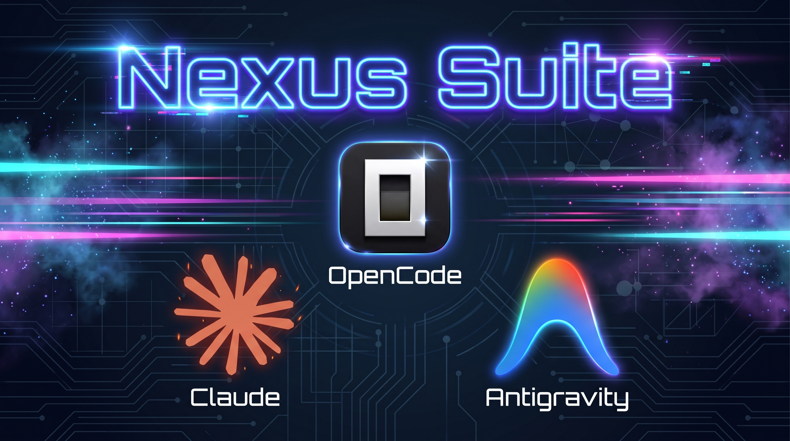
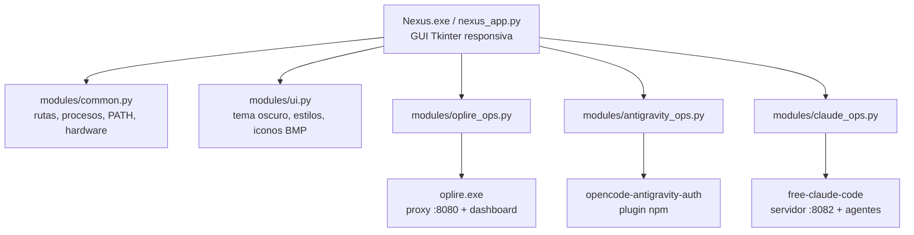

<h1 align="center">OpenCode NEXUS Suite</h1>

<p align="center">
  <strong>Una sola consola de escritorio para tres motores de IA.</strong><br>
  <sub>Python 3 (Tkinter) + motor Rust + integración npm/uv · Windows 10/11 · v7.3.1</sub>
</p>

<p align="center">
  
  
  
  
  
</p>

<p align="center">
  <a href="#que-es">Qué es</a> •
  <a href="#modulos">Módulos</a> •
  <a href="#requisitos">Requisitos</a> •
  <a href="#instalacion">Instalación</a> •
  <a href="#uso">Uso</a> •
  <a href="#releases">Releases</a> •
  <a href="#creditos">Créditos</a> •
  <a href="#aviso-importante">Aviso importante</a>
</p>

---

## ¿Qué es?

**NEXUS Suite** es una aplicación de escritorio escrita en Python (Tkinter) que agrupa en
una única interfaz **tres motores** que normalmente se gestionan por separado desde la
terminal. Cada motor conserva su propio ciclo de vida, su propia licencia y su propio
repositorio upstream; NEXUS solo aporta la capa de lanzamiento, diagnóstico, respaldo y
mantenimiento.

El proyecto nació como una evolución del motor **Oplire** (V1–V5), se reorganizó como
servicios independientes (V6) y maduró hasta la suite unificada actual (V7.x).

## Módulos

| Módulo | Motor upstream | Lenguaje | Qué gestiona NEXUS |
| --- | --- | --- | --- |
| **OpenCode / Oplire** | [BerkeOruc/oplire](https://github.com/BerkeOruc/oplire) (`oplire-reset` 4.0.0) | Rust | Servidor local proxy + dashboard web, túnel WARP y configuración de red, copia de seguridad y restauración de sesiones, mantenimiento de caché, diagnóstico (`doctor`) |
| **Antigravity** | [NoeFabris/opencode-antigravity-auth](https://github.com/NoeFabris/opencode-antigravity-auth) (1.6.0) | TypeScript (npm) | Cuentas Google registradas en el plugin, instalación/actualización y reparación del plugin, catálogo de modelos, lectura de cuotas |
| **Claude (FCC)** | [Alishahryar1/free-claude-code](https://github.com/Alishahryar1/free-claude-code) (AGPL-3.0) | Python (uv) | Arranque y detención del servidor local, perfiles de agentes, edición del archivo `~/.fcc/.env`, asistente de diagnóstico |

> Los tres motores son **proyectos de terceros**. NEXUS no los reescribe: los localiza, los
> invoca y vela por su mantenimiento. Cada componente mantiene la licencia con la que se
> publica ([detalle en `docs/LICENCIAS.md`](docs/LICENCIAS.md)).

## Arquitectura



La GUI tiene **13 páginas** navegables desde una barra lateral: `Inicio`, `IP / WARP`,
`Servidor`, `Caché`, `Mantenimiento`, `AG Cuentas`, `AG Plugin`, `AG Modelos`, `Claude`,
`AG Agentes`, `Claude Doctor`, `Sistema` y `Acerca de`. Cada página declara sus propios
botones y su refresco; hay un tick global de 1 s que solo actualiza la página activa, y
**F5** refresca todo.

Documentación extendida:

| Documento | Contenido |
| --- | --- |
| [`docs/INSTALACION.md`](docs/INSTALACION.md) | Requisitos, instalación de motores, compilación del binario |
| [`docs/USO.md`](docs/USO.md) | Guía de uso página por página de la suite |
| [`docs/ARQUITECTURA.md`](docs/ARQUITECTURA.md) | Módulos Python, flujo de datos, rutas y variables |
| [`docs/LICENCIAS.md`](docs/LICENCIAS.md) | Licencias y obligaciones de cada componente |
| [`docs/HISTORIAL.md`](docs/HISTORIAL.md) | Evolución V1 → V7.3.1 |
| [`docs/CONTRIBUCION.md`](docs/CONTRIBUCION.md) | Cómo colaborar y convención de código |

## Requisitos

| Componente | Mínimo | Para qué |
| --- | --- | --- |
| Windows | 10 o 11 (x64) | Plataforma soportada |
| Python | 3.10+ con Tkinter | Ejecutar la GUI |
| Rust | 1.75+ | Compilar `oplire.exe` (opcional si descargas el binario) |
| Node.js + npm | LTS | Instalar el plugin de Antigravity |
| [uv](https://docs.astral.sh/uv/) | Cualquier versión reciente | Entorno del módulo Claude |
| Cloudflare WARP | Team/One Client | Funciones de red del motor Oplire |
| Permisos | Administrador | Solo para operaciones de red y `HKCU\Environment` |

## Instalación

```bat
git clone https://github.com/PolloCraft/OpenCode-Nexus.git
cd OpenCode-Nexus
python Nexus\nexus_app.py
```

También puedes hacer doble clic en **`Iniciar Nexus.bat`**: usa `Nexus.exe` si existe y, si
no, arranca la GUI con Python.

Para compilar el motor Rust:

```powershell
powershell -ExecutionPolicy Bypass -File .\Nexus\oplire\build.ps1 -Release
```

`oplire.exe` se busca en `Nexus\oplire\target\release`, en `%LOCALAPPDATA%\Nexus\bin` o en
la ruta que defina la variable `NEXUS_OPLIRE_EXE`.

Los instaladores completos, el alta de los motores y la creación del `.exe` están detallados
en [`docs/INSTALACION.md`](docs/INSTALACION.md).

## Uso

Resumen rápido; la guía completa página por página está en [`docs/USO.md`](docs/USO.md).

| Quiero… | Página |
| --- | --- |
| Ver el estado general y lanzar acciones rápidas | **Inicio** |
| Comprobar el estado de red/WARP y restaurar la configuración desde respaldo | **IP / WARP** |
| Arrancar el dashboard local e inspeccionar tráfico proxy | **Servidor** |
| Limpiar caché local y respaldar/restaurar sesiones | **Caché** |
| Ejecutar `doctor`, reparar dependencias y editar el `PATH` | **Mantenimiento** |
| Revisar cuentas, plugin y modelos de Antigravity | **AG Cuentas / AG Plugin / AG Modelos** |
| Configurar y arrancar el servidor de Free Claude Code | **Claude / Claude Doctor** |
| Auditar hardware, red y dependencias del equipo | **Sistema** |

## Variables de entorno

| Variable | Uso | Valor sugerido |
| --- | --- | --- |
| `OPENCODE_EXPERIMENTAL_OUTPUT_TOKEN_MAX` | Tope de tokens de salida de OpenCode | `512000` |
| `OPENCODE_CONFIG_DIR` | Carpeta de configuración de OpenCode | — |
| `OPENCODE_BIN` / `NEXUS_OPENCODE` | Ruta explícita al ejecutable de OpenCode | — |
| `NEXUS_OPLIRE_EXE` | Ruta a `oplire.exe` | — |
| `OPLIRE_PROJECT_PATH` | Carpeta del motor Oplire | — |
| `ANTIGRAVITY_PROJECT_PATH` | Carpeta del plugin Antigravity | — |
| `CLAUDE_PROJECT_PATH` | Carpeta de Free Claude Code | — |
| `GOOGLE_GENERATIVE_AI_API_KEY` | API key de Google AI Studio | — |
| `GEMINI_API_KEY` | Alias usado por la CLI de Gemini y FCC | — |
| `NO_PROXY` | Hosts que no deben pasar por el proxy | `127.0.0.1,localhost` |

Puedes editarlas desde **Mantenimiento → PATH / Variables**, que escribe en
`HKCU\Environment` y emite `WM_SETTINGCHANGE` para que las apliquen los procesos nuevos.

## Estructura del repositorio

```text
OpenCode-Nexus/
├─ Iniciar Nexus.bat              Lanzador Windows (.exe si existe, si no Python)
├─ assets/banner.jpg              Banner del proyecto
├─ docs/                          Documentación técnica y de uso
├─ Nexus/
│  ├─ nexus_app.py                GUI principal (13 páginas, responsiva)
│  ├─ nexus_menu.py               Menú de consola integral
│  ├─ antigravity_menu.py         Menú de consola de Antigravity
│  ├─ modules/
│  │  ├─ common.py                Rutas, procesos, PATH, hardware, auditoría
│  │  ├─ ui.py                    Tema oscuro, estilos, iconos, LogBox
│  │  ├─ oplire_ops.py            Operaciones del motor Rust
│  │  ├─ antigravity_ops.py       Cuentas, plugin, modelos, cuotas
│  │  └─ claude_ops.py            Servidor, agentes y `.env` de FCC
│  └─ oplire/                     Motor Rust (fork MIT de Oplire)
├─ LICENSE                         Licencia del código propio
└─ README.md
```

Las carpetas `Nexus/claude/` y `Nexus/antigravity/` **no se versionan**: son copias de
trabajo de los upstream que la propia suite instala (`npm` / `uv`). Los binarios
(`Nexus.exe`, `*.dll`, `target/`, `node_modules/`, `.venv/`, `uv.exe`) también quedan fuera.

## Releases

| Release | Época | Qué era |
| --- | --- | --- |
| [`v1.0.0`](https://github.com/PolloCraft/OpenCode-Nexus/releases/tag/v1.0.0) → [`v5.0.0`](https://github.com/PolloCraft/OpenCode-Nexus/releases/tag/v5.0.0) | **Oplire** (V1–V5) | Herramienta Rust nativa con funciones propias: proxy, WARP, dashboard y menú. Sin GUI Python. |
| [`v6.0.0`](https://github.com/PolloCraft/OpenCode-Nexus/releases/tag/v6.0.0) | **Nexus temprano** | Primer empaquetado: tres servicios **independientes** (`Nexus-Claude`, `OpenCode-Oplire`, `Opencode-Antigravity`) sin consola común. |
| [`v7.2.0`](https://github.com/PolloCraft/OpenCode-Nexus/releases/tag/v7.2.0) | **Suite unificada** | GUI Tkinter única, `modules/` compartidos, `Nexus.exe` con PyInstaller y Oplire 4.0.0 embebido. |
| [`v7.3.0`](https://github.com/PolloCraft/OpenCode-Nexus/releases/tag/v7.3.0) / [`v7.3.1`](https://github.com/PolloCraft/OpenCode-Nexus/releases/tag/v7.3.1) | **Actual** | Se incorpora el módulo Claude (FCC), 13 páginas, diagnóstico y gestión de variables. |

Descargas y notas completas en [Releases](https://github.com/PolloCraft/OpenCode-Nexus/releases).
Cada release publica un paquete reconstruido **sin artefactos de compilación ni `.git/` de
terceros**, su `SHA256SUMS.txt` y un `MANIFEST.txt` que detalla qué se excluyó y por qué.

## Créditos

NEXUS Suite es trabajo de integración y capa de usuario; los motores son obra de otras
personas, y este proyecto existe gracias a ellas.

| Persona / Proyecto | Rol | Licencia |
| --- | --- | --- |
| **[@PolloCraft](https://github.com/PolloCraft)** | Autor y desarrollador de NEXUS Suite: GUI, capa de operaciones, empaquetado y documentación | MIT |
| **[@BerkeOruc](https://github.com/BerkeOruc)** — [**oplire**](https://github.com/BerkeOruc/oplire) | Motor Rust original del módulo OpenCode (`oplire-reset`) | MIT |
| **[@NoeFabris](https://github.com/NoeFabris)** — [**opencode-antigravity-auth**](https://github.com/NoeFabris/opencode-antigravity-auth) | Plugin de autenticación Antigravity consumido por el módulo Antigravity | MIT |
| **[@Alishahryar1](https://github.com/Alishahryar1)** — [**free-claude-code**](https://github.com/Alishahryar1/free-claude-code) | Motor del módulo Claude (FCC) | AGPL-3.0-only |

Enlace de upstream, aviso de modificación y textos de licencia en [`docs/LICENCIAS.md`](docs/LICENCIAS.md).

## Aviso importante

Lee esto antes de usar la suite:

- **No es un instrumento para saltarse límites de uso.** Las cuotas y restricciones las
  aplica el servidor del proveedor. NEXUS no está documentado ni soportado para eludir
  límites de cuenta, cuotas de modelos “gratuitos” o controles de la app oficial, y no se
  aceptan contributiones orientadas a eso.
- **Ningún componente es oficial.** No hay afiliación con Anthropic, Google, OpenCode ni
  Cloudflare. El propio upstream de Antigravity avisa de que su uso puede incumplir los
  Términos de Servicio de Google; Free Claude Code declara no estar avalado por Anthropic.
- **Toca tu red y tus credenciales.** Las operaciones de red, el bypass de configuración de
  OpenCode Desktop y la edición de `PATH`/`HKCU\Environment` pueden afectar a tu equipo.
  La suite respalda antes de modificar, pero **haz tu propia copia** y no operes sin permisos
  de administrador cuando se requieran.
- **Bajo tu responsabilidad.** El uso que hagas de la suite y de los motores de terceros es
  tuyo; este software se entrega “tal cual”, sin garantía.

## Licencia

- El **código propio de NEXUS Suite** (GUI, `modules/`, menús y lanzador) se publica bajo
  **MIT** — ver [`LICENSE`](LICENSE).
- `Nexus/oplire/` mantiene la **MIT de Berke Oruc** y sus aviso de copyright.
- Los motores **Antigravity** (MIT) y **Free Claude Code** (AGPL-3.0-only) se obtienen de sus
  repositorios upstream y conservan sus términos; las obligaciones de cada uno se resumen en
  [`docs/LICENCIAS.md`](docs/LICENCIAS.md).

---

<sub>Hecho con Python, Rust y bastante paciencia por **PolloCraft**. Si te resulta útil,
considera darle una estrella y reportar fallos en [Issues](https://github.com/PolloCraft/OpenCode-Nexus/issues).</sub>
